<!--
  THE WORLD IS YOURS — perfil de Vinicius Gabriel
  Arte original em SVG (assets/). Paleta: #080808 · #FFFFFF · #B31320 · #D4AF37
  Imagens com versão para celular usam o elemento picture (telas de até 560px).
-->

<picture>
  <source media="(max-width: 560px)" srcset="./assets/banner-mobile.svg" />
  
</picture>

  

<!-- Frase de impacto -->
<picture>
  <source media="(max-width: 560px)" srcset="./assets/quote-mobile.svg" />
  
</picture>

  



<!-- ═════════════════════════ ACT I ═════════════════════════ -->

<picture>
  <source media="(max-width: 560px)" srcset="./assets/act-1-mobile.svg" />
  
</picture>

<picture>
  <source media="(max-width: 560px)" srcset="./assets/terminal-mobile.svg" />
  
</picture>

<!-- ═════════════════════════ ACT II ════════════════════════ -->

<picture>
  <source media="(max-width: 560px)" srcset="./assets/act-2-mobile.svg" />
  
</picture>

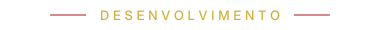
 
<picture>
  <source media="(max-width: 560px)" srcset="https://skillicons.dev/icons?i=py,js,ts,react,nextjs,html,css,tailwind&theme=dark&perline=4" />
  
</picture>

  

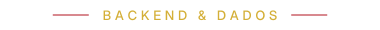
 

  

 

  

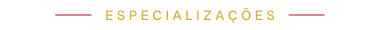
 
<picture>
  <source media="(max-width: 560px)" srcset="./assets/specializations-mobile.svg" />
  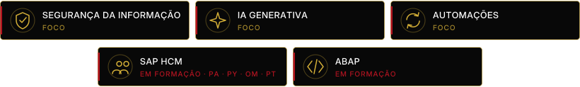
</picture>

  

<!-- ═════════════════════════ ACT III ═══════════════════════ -->

<picture>
  <source media="(max-width: 560px)" srcset="./assets/act-3-mobile.svg" />
  
</picture>

<a href="https://github.com/Vinissaos/vg-rural">
  <picture>
    <source media="(max-width: 560px)" srcset="./assets/project-vg-rural-mobile.svg" />
    
  </picture>
</a>

  

<!--
  Novo projeto real: copie o bloco do VG Rural acima, troque o link
  e crie os cards em assets/ (versão desktop e -mobile).
-->
<picture>
  <source media="(max-width: 560px)" srcset="./assets/project-next-mobile.svg" />
  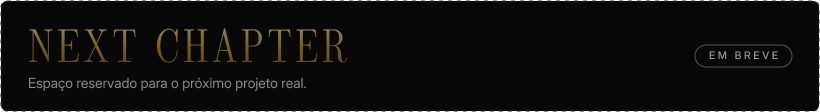
</picture>

<!-- ═════════════════════════ ACT IV ════════════════════════ -->

<picture>
  <source media="(max-width: 560px)" srcset="./assets/act-4-mobile.svg" />
  
</picture>

<!-- Gerado por .github/workflows/stats.yml a partir da API do GitHub (dados reais, atualização diária). -->
<picture>
  <source media="(max-width: 560px)" srcset="./assets/stats-mobile.svg" />
  
</picture>

  

  

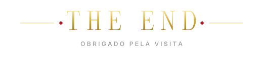

